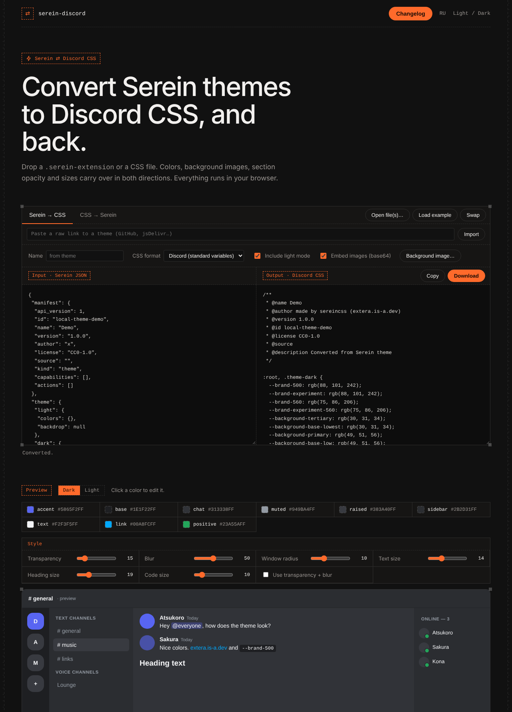

# Serein ⇄ Discord CSS

Convert **Serein** themes (`.serein-extension`) to **Discord CSS** and back, right in the browser.
Live site: **https://extera.is-a.dev**



## Features

- **Both directions.** Serein theme → Discord CSS, and Discord CSS → Serein theme. The direction is detected from the file contents.
- **Two CSS flavors.** Standard Discord variables (`--background-primary`, `--brand-500`, …) or Discord Mica (`--dark-*` / `--light-*`).
- **Themes without variables.** CSS written as plain rules (no `--name` variables) is handled too: the palette, link and accent colors, section opacity, window radius and font size are guessed from how often values appear. This is approximate.
- **Images.** Background and cover images are embedded as base64 and restored on the way back. You can also attach your own background image. A wallpaper URL found in a CSS file is downloaded when the host allows it.
- **Live preview.** A Discord-like mockup with a Dark / Light switch, built from the loaded theme.
- **Color and style editor.** Click a swatch to change a color; sliders for transparency, blur, window radius and text sizes.
- **Import by link.** Paste a raw GitHub / jsDelivr link, or open `https://extera.is-a.dev/?import=<raw-url>`. `@import` files are followed when the CSS has no variables of its own.
- **Batch mode.** Select or drop several files and download the results as a ZIP.
- **Session is remembered** in your browser (localStorage). Use *Clear saved session* in the footer to reset.
- **English / Русский / Українська** interface. The language follows your browser (English is the fallback); the header button switches it manually.
- Everything runs locally. No files are uploaded anywhere.

## How colors are mapped

| Serein | Standard Discord CSS | Discord Mica |
|---|---|---|
| `accent` | `--brand-500`, `--brand-experiment` (+ darker shades) | `--dark-accent` |
| `base` | `--background-tertiary`, `--background-base-lowest` | `--dark-bg` |
| `chat` | `--background-primary`, `--background-base-low` | `--dark-flyout` |
| `sidebar` | `--background-secondary`, `--background-base-lower` | `--dark-background-accent` |
| `raised` | `--background-floating`, `--background-surface-high` | `--dark-button` |
| `muted` | `--text-muted` | `--dark-button-border` |
| `text` | `--text-normal`, `--text-default`, `--header-primary` | `--dark-button-font-color` |
| `hover`, `link`, `mention_*`, `positive`, `warning`, `danger` | matching Discord variables | `--serein-<mode>-color-*` |

Anything Discord has no variable for (transparency, blur, section opacity, sizes, backdrop gradient) is stored as `--serein-*` variables, so a Serein → CSS → Serein round trip loses nothing.

## Hosting

It is a static site, no build step. Put these files in the root of a GitHub Pages (or any static host) repository:

```
index.html            the converter (single file)
404.html              not-found page
og.png                link preview card
favicon.svg
favicon.ico
favicon-32.png
apple-touch-icon.png
screenshot.png        used by this README
README.md
```

## Notes and limits

- Importing by link needs a host that allows cross-origin requests (`raw.githubusercontent.com` and jsDelivr do; many sites do not).
- Heuristic conversion of variable-less CSS gives a starting palette, not a pixel-perfect copy. Use the color editor to fix anything that looks off.
- Converted files carry the credit `made by sereincss (extera.is-a.dev)` as their author.

---

## По-русски

Конвертер тем **Serein** (`.serein-extension`) в **Discord CSS** и обратно, работает прямо в браузере: **https://extera.is-a.dev**

Что умеет: конвертация в обе стороны с автоопределением направления; два формата CSS (стандартные переменные Discord и Discord Mica); темы без переменных (палитра подбирается по правилам, приблизительно); фоновые и обложечные картинки; предпросмотр с переключением тёмной и светлой темы; редактор цветов и ползунки стиля; импорт по ссылке (`?import=<ссылка>`); пакетная обработка с ZIP; запоминание последней сессии; интерфейс на русском и английском. Файлы никуда не отправляются.
